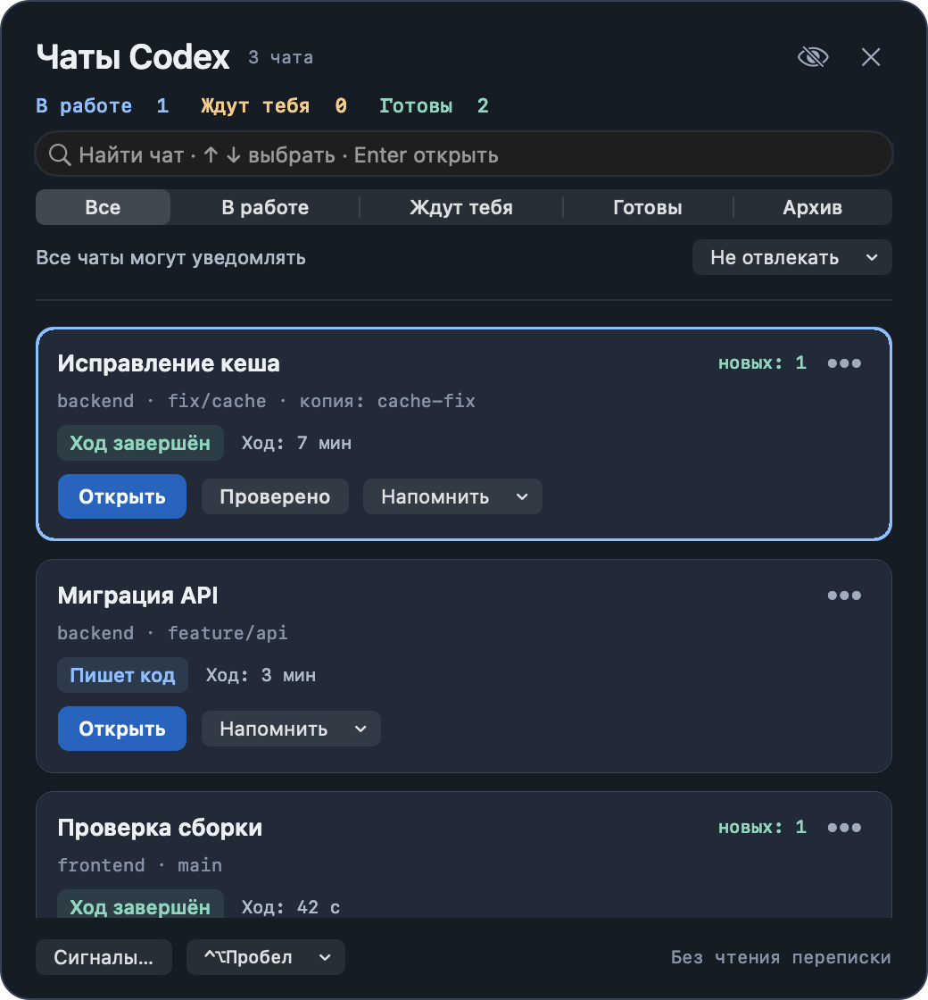

# Codex Notch

Маленький робот у выреза Mac и компактный пульт локальных задач Codex.
Нативное приложение на Swift/AppKit, без пакетов, API-ключей, серверов и телеметрии.

[Краткая презентация: 7 слайдов](docs/codex-notch-guide.pptx)



## Каждый день

- **Быстрый переход.** `⌃⌥Пробел` открывает поиск по названиям чатов. `↑` / `↓` выбирают строку, `Enter` открывает чат, `Esc` закрывает пульт. Сочетание меняется внизу пульта, включая запись собственного.
- **Контекст разработки.** Под чатом видны проект, Git-ветка и связанная рабочая копия. Полный локальный путь доступен в подсказке.
- **Результаты.** Кнопка «Результат» открывает явно прикреплённый агентом локальный отчёт или документ. Итог проверок подписан «Агент сообщил». Завершение хода само по себе не означает успех.
- **Проверка результата.** Открытый важный результат переходит в «На проверке». Только «Проверено» убирает его из очереди. Повторное открытие уже проверенного файла не возвращает его в очередь.
- **Спокойные уведомления.** Короткие обычные ходы обновляют счётчик. Обычный ход от минуты может показать карточку, если Codex не на переднем плане. Явные вопросы сохраняют приоритет. После сна или накопления событий появляется одна сводка.
- **Ожидание группы.** В меню «…» работающих чатов выберите ходы, затем «Ожидание…» → «Ждать выбранные ходы». Пульт показывает прогресс и один раз сообщает, когда все выбранные ходы закончатся. Остановки, закрытия и смена хода отмечаются отдельно. Новые ходы не добавляются автоматически.
- **Локальный архив.** Меню «…» скрывает старый чат из обычного списка. Вкладка «Архив» позволяет вернуть его. Новый ход или результат возвращает чат автоматически. Непроверенное, напоминания и активная работа защищены. Чаты Codex не изменяются.
- **Демонстрация экрана.** Перечёркнутый глаз скрывает названия, пути, ID и подсказки внутри Codex Notch. Остаются «Задача 1», состояния и счётчики. При открытии Codex или файла действует интерфейс соответствующего приложения.

Левый клик по роботу/значку меню открывает пульт под вырезом. На внешнем дисплее он
появляется под значком в строке меню. Правый клик открывает настройки и диагностику.
Пульт не раскрывается автоматически. Закрытие: `Esc`, повторный клик или клик снаружи.

Робот занимает 32 пункта справа от физического выреза внутри чёрного продолжения.
Физическая камера не содержит пикселей для рисования. На Mac без выреза и внешнем
экране используется штатный значок меню. На заполненной строке меню персонажа можно скрыть.

## Скины персонажа

«Скин» в заголовке пульта или «Персонаж» в меню робота переключает четыре образа:
робот, кот, привидение и космонавт. Меняется сам силуэт и выражения, состояния и действия
остаются одинаковыми. Выбор сохраняется локально и применяется к вырезу, карточке состояния
и значку внешнего дисплея. Все персонажи нарисованы штатным AppKit, ничего не загружается.

## Работа при погасшем экране

Переключатель «Не усыплять Mac во время работы» удерживает **автоматический сон системы**,
пока в локальных hooks видны свежие активные ходы. Экран может погаснуть и заблокироваться.
Когда последний ход завершён, прерван, устарел либо ждёт явного ответа, удержание снимается.
Вопрос исключает только свой чат, другие активные чаты могут продолжать работу.
Выбор важного чата и тихий режим на удержание не влияют. По умолчанию переключатель выключен.
На батарее расход заряда может увеличиться. Сохраняется только предпочтение: старые карточки
после перезапуска и демонстрация не считаются выполняющейся работой.

Используется штатный IOKit `PreventUserIdleSystemSleep` без sudo, helpers и изменения `pmset`.
Каждое удержание ограничено 120 секундами и продлевается исправным циклом приложения.
При выходе оно снимается; зависшее приложение перестаёт продлевать его. После системного сна
для возобновления нужно новое реальное событие, старое состояние не восстанавливает удержание.
Ошибки IOKit видны в пульте и диагностике, повтор выполняется не чаще раза в 30 секунд.

**Закрытие крышки, ручная команда «Сон», низкий заряд и политики рабочего Mac этим API
не отменяются.** Для работы с закрытой крышкой нужен поддерживаемый macOS режим
с внешним монитором, питанием и внешними устройствами ввода.
Утилита не гарантирует продолжение после выхода Codex, потери сети или ожидания пользователя.

Источники Apple: [IOPM assertion](https://developer.apple.com/documentation/iokit/kiopmassertiontypepreventuseridlesystemsleep),
[QA1340](https://developer.apple.com/library/archive/qa/qa1340/_index.html),
[работа с закрытой крышкой](https://support.apple.com/en-us/102501).

## Запуск и подключение

1. Откройте `run.command`. При отсутствии сборки он использует уже установленные Apple Command Line Tools. Ничего не скачивается и не добавляется в Applications или автозагрузку.
2. Откройте `connect.command`. Он добавит только свои восемь обработчиков в `~/.codex/hooks.json`, сохранив существующие и точную резервную копию.
3. В терминале запустите `codex`, откройте `/hooks`, проверьте и доверьте новые обработчики. Затем откройте новый чат.

Доверие к пользовательским hooks подтверждается самим пользователем по
[контракту Codex Hooks](https://learn.chatgpt.com/docs/hooks).
Программа не меняет записи доверия и не принимает решений об одобрении действий.
Обновление приложения по прежнему пути сохраняет команду уже подключённых hooks.

`run.command` применяет системный профиль `offline.sb` с запретом сетевых вызовов.
При прямом запуске `.app` профиль не применяется, сетевого кода всё равно нет.
Для запуска нужны macOS 13+ и Apple Command Line Tools для первоначальной сборки.

## Честные состояния

| Видно в пульте | Основание |
| --- | --- |
| Разбирается в задаче | `UserPromptSubmit` или работа инструмента |
| Пишет код | Редактирование через `apply_patch`, `Edit`, `Write` |
| Проверка действия | `PermissionRequest`, без автоматической карточки |
| Ход завершён | `Stop` основного хода |
| Остановлен | `Interrupt` |
| Нет свежих событий | 30 минут без сигналов |
| Нужен твой ответ / Посмотри результат | Только явный маркер агента |

`PermissionRequest` возникает до решения политики или Auto-review и не доказывает,
что человеку показали диалог разрешения. Поэтому он никогда не вызывает просьбу
об ответе или автоматическую карточку. Долгое выполнение команды это правило не меняет.

После перезапуска старые работающие чаты показываются как последнее известное состояние
до нового события. Облачные выполнения и пути инструментов без локальных hooks не видны.

## Явные сигналы и отчёты

Кнопка «Сигналы…» копирует инструкцию для нужного чата. Агент отправляет отдельную
точную no-op команду непосредственно перед настоящим вопросом или просьбой проверить:

```sh
: codex-notch:question
: codex-notch:review
: codex-notch:clear
```

Для результата используется `: codex-notch:result BASE64`. BASE64 содержит UTF-8 JSON:

```json
{"checks":"notRun","path":"/absolute/path/report.md"}
```

`checks`: `passed`, `failed`, `notRun`. `path` необязателен, файл должен уже существовать.
Принимаются документы, отчёты, изображения и diff. Скрипты, приложения, пакеты и
символические ссылки не открываются. Путь проверяется повторно при нажатии.
Пример формирования маркера без файла:

```sh
python3 -c 'import base64,json; print(": codex-notch:result " + base64.b64encode(json.dumps({"checks":"notRun"}).encode()).decode())'
```

Полученную строку агент выполняет отдельной shell-командой. Печать строки сама сигнал
не отправляет. Hooks распознают только точный маркер `PostToolUse` у Bash,
`exec_command.cmd` и `shell_command.command`. Составные команды, echo и JavaScript
не анализируются. ID чата/хода берутся из события. Устаревшие и несовпадающие ходы
игнорируются. Никакого чтения переписки или угадывания успешности по словам агента.

Для собственной интеграции также доступно:
`--attention question|review|clear --session UUID --turn TURN_ID`.

## Тишина, приоритет и напоминания

«Не отвлекать» включает тишину на 25/30 минут, час или до выключения. Очередь продолжает
пополняться. После тишины появляется одна сводка оставшихся событий. На неактивной
пользовательской сессии сводка ждёт возвращения. Вопросы могут отложить итог группы
и напоминания, чтобы карточки не перекрывали друг друга.

В «…» можно выбрать один чат для обычных уведомлений. Остальные остаются в очереди.
«Напомнить» возвращает к результату через 5/10/30 минут или один раз сообщает,
если текущий ход длится дольше 10/20/30 минут. Длительность не называется зависанием.
Ручные напоминания и выбранная группа соблюдают тишину, выбор одного чата их не отменяет.

## Локальные данные и разрешения

- Apple AppKit, Foundation, SQLite и Carbon. Внешних библиотек нет.
- Hooks отбрасывают запросы, произвольные команды, код, результаты инструментов и переписку. На диск попадают события/ID/время, `cwd` и явно переданные метаданные результата.
- `.codex-notch-runtime` рядом с `.app`: папка `0700`, файлы `0600`. События удаляются после чтения, очередь событий ограничена 256 файлами. Повреждённая библиотека не перезаписывается.
- Локальная библиотека хранит до 256 чатов, 512 результатов и просьб внимания, подписи, архив, таймеры, выбранные ходы, отметки проверки и режим демонстрации. Границы дедупликации — 4096 ключей.
- Имена чатов: только `threads.id` / `threads.name` известных чатов из локальной SQLite в режиме чтения. Автоматические имена остаются в памяти. Ручная подпись имеет приоритет.
- Контекст: `cwd` корневого запуска/запроса и ограниченные `.git` / `HEAD` / `gitdir` / `commondir`. Код, Git-конфигурация, remotes и история не читаются. Фоновые дочерние инструменты не подменяют корневой каталог.
- Accessibility, запись экрана, контакты и ключи не нужны. Carbon регистрирует одно сочетание. Клавиатура обрабатывается только в открытом пульте. Режим демонстрации включается вручную.

Схема локальной SQLite Codex не является стабильным API. При несовместимости остаётся
ручная подпись или «Чат без названия», причина видна в диагностике. Источник ищется в
`CODEX_SQLITE_HOME`, `CODEX_HOME`, `~/.codex`; точный путь можно задать
`CODEX_NOTCH_STATE_DB`. Для изолированных проверок используется `CODEX_NOTCH_DATA_DIR`.

## Проверка и демонстрация

```sh
./build.command
./test.command
# Дополнительно: короткая проверка настоящего IOKit без изменения настроек
CODEX_NOTCH_TEST_NATIVE_POWER=1 ./test.command
./run.command --health --self-test
./run.command --preview panel.png --preview-dashboard
./run.command --preview result.png --preview-dashboard --preview-scene result
./run.command --preview sharing.png --preview-dashboard --preview-scene sharing
./run.command --preview group.png --preview-dashboard --preview-scene group
```

Preview рисует только собственное окно с выдуманными задачами, не читает живую очередь
и не записывает экран. `--compact-preview --preview-scale 8` экспортирует самого робота.
Тест Carbon-регистрации требует полноценной пользовательской GUI-сессии.
«Проверить подключение…» и `--health` проверяют путь, настройки, локальные права и свежесть
событий. Доверие Codex к hooks они не угадывают. `disconnect.command` удаляет только свои hooks.
